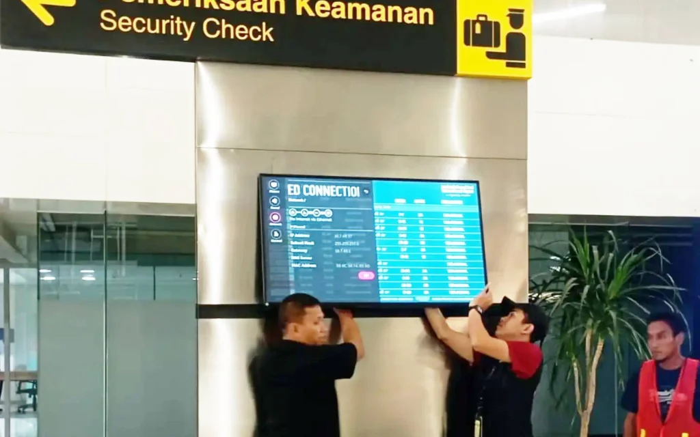

Reliable airport operations begin with reliable information. At **Jenderal Ahmad Yani International Airport, Semarang**, INALIX successfully completed the installation of a **98-inch Airport Information Display**, supporting the airport's commitment to improving passenger information services and strengthening its digital information infrastructure.

Designed for high-visibility environments, the large-format display provides a clear and accessible platform for presenting essential airport information. Its expansive screen size enables passengers and airport visitors to view important updates more conveniently, contributing to a smoother passenger experience and more efficient information delivery throughout the terminal.

The implementation involved a comprehensive installation process, from site preparation and secure mounting to system integration, configuration, and final testing. Each stage was carried out with careful attention to technical requirements, installation quality, and operational reliability to ensure the display performs effectively within the demanding environment of a modern airport.

With airport facilities operating around the clock, reliable information display infrastructure plays an important role in maintaining consistent communication and supporting daily operational activities. Through this project, INALIX demonstrates its expertise in delivering professional display installations and integrated technology solutions tailored to the specific needs of airport environments.

### Project Highlights

- **98-Inch Commercial Display Installation:** Deployment of a large-format display designed to provide clear visibility in airport terminal environments.
- **Professional On-Site Implementation:** Precise installation, secure mounting, configuration, and commissioning by the INALIX technical team.
- **Airport Information System Integration:** Integration with the airport's information system to support centralized and consistent information delivery.
- **Enhanced Information Visibility:** Improved presentation and accessibility of essential operational information for passengers and airport stakeholders.
- **Operational Reliability:** A display solution designed to support continuous operation in demanding airport environments.

This implementation further reflects INALIX's commitment to delivering dependable airport technology infrastructure through technical expertise, attention to detail, and a strong understanding of operational requirements.

As a technology solutions provider specializing in airport systems and infrastructure, INALIX continues to support the modernization of airport facilities through reliable, integrated, and scalable solutions that enhance operational efficiency and passenger experience.

**At INALIX, we deliver more than technology. We deliver dependable infrastructure that keeps airports connected, informed, and operating efficiently.**

**Engineered for Performance. Built for Airports.**
