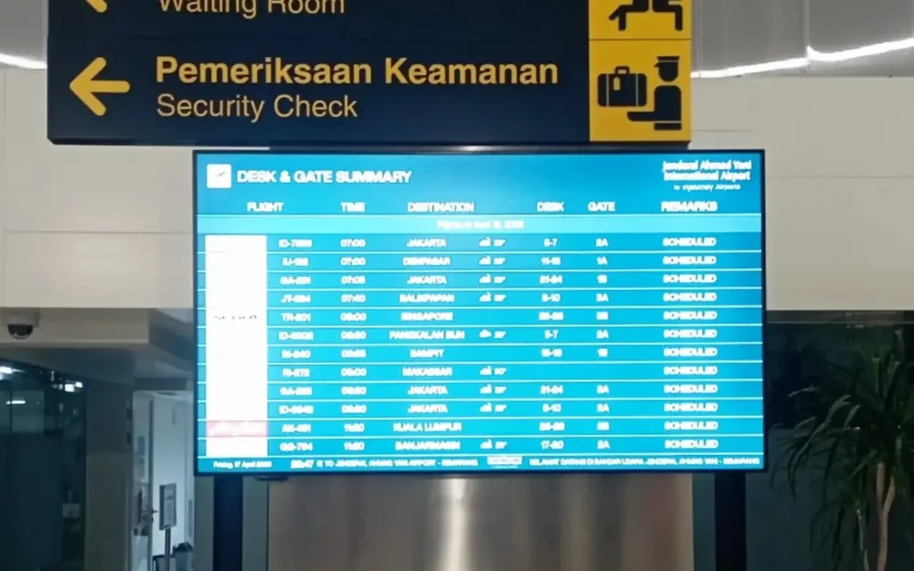

Operasional bandara yang andal dimulai dari ketersediaan informasi yang akurat dan mudah diakses. Di **Bandara Internasional Jenderal Ahmad Yani, Semarang**, INALIX berhasil menyelesaikan instalasi **Airport Information Display berukuran 98 inci** sebagai bagian dari upaya mendukung peningkatan layanan informasi penumpang dan penguatan infrastruktur informasi digital bandara.

Dirancang untuk lingkungan yang membutuhkan visibilitas tinggi, display berukuran besar ini menghadirkan sarana penyampaian informasi yang jelas dan mudah diakses. Dengan ukuran layar yang luas, penumpang dan pengunjung bandara dapat melihat berbagai informasi penting secara lebih nyaman, sehingga mendukung pengalaman perjalanan yang lebih baik serta penyampaian informasi yang lebih efisien di area terminal.

Proses implementasi mencakup berbagai tahapan teknis, mulai dari persiapan lokasi, pemasangan perangkat secara aman, integrasi sistem, konfigurasi, hingga pengujian akhir. Setiap tahapan dilaksanakan dengan memperhatikan persyaratan teknis, kualitas instalasi, dan keandalan operasional untuk memastikan perangkat dapat berfungsi secara optimal dalam lingkungan bandara modern.

Mengingat fasilitas bandara beroperasi secara berkelanjutan, infrastruktur display informasi yang andal memiliki peran penting dalam menjaga konsistensi komunikasi serta mendukung kelancaran aktivitas operasional sehari-hari. Melalui proyek ini, INALIX menunjukkan kapabilitasnya dalam menghadirkan instalasi display profesional dan solusi teknologi terintegrasi yang disesuaikan dengan kebutuhan lingkungan kebandarudaraan.

### Sorotan Proyek (Project Highlights)

- **Instalasi Commercial Display 98 Inci:** Implementasi layar berukuran besar untuk menghadirkan visibilitas informasi yang optimal di lingkungan terminal bandara.
- **Implementasi Profesional di Lokasi:** Pelaksanaan instalasi, pemasangan perangkat, konfigurasi, dan commissioning secara presisi oleh tim teknis INALIX.
- **Integrasi Sistem Informasi Bandara:** Integrasi dengan sistem informasi bandara untuk mendukung penyampaian informasi secara terpusat dan konsisten.
- **Peningkatan Visibilitas Informasi:** Optimalisasi tampilan dan aksesibilitas informasi operasional bagi penumpang serta pemangku kepentingan bandara.
- **Keandalan Operasional:** Solusi display yang dirancang untuk mendukung pengoperasian secara berkelanjutan dalam lingkungan bandara dengan kebutuhan operasional tinggi.

Implementasi ini semakin menegaskan komitmen INALIX dalam menghadirkan infrastruktur teknologi kebandarudaraan yang andal melalui keahlian teknis, perhatian terhadap detail, serta pemahaman mendalam terhadap kebutuhan operasional bandara.

Sebagai penyedia solusi teknologi yang berfokus pada sistem dan infrastruktur kebandarudaraan, INALIX terus mendukung modernisasi fasilitas bandara melalui solusi yang andal, terintegrasi, dan skalabel untuk meningkatkan efisiensi operasional serta kualitas pengalaman penumpang.

**Bagi INALIX, menghadirkan teknologi bukan sekadar menyediakan perangkat, tetapi juga membangun infrastruktur yang dapat diandalkan untuk menjaga konektivitas, ketersediaan informasi, dan efisiensi operasional bandara.**

**Dirancang untuk Performa Optimal. Dibangun untuk Kebutuhan Bandara.**
